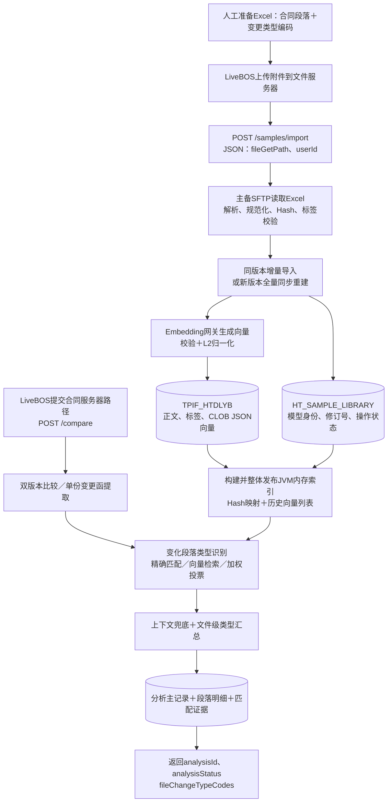
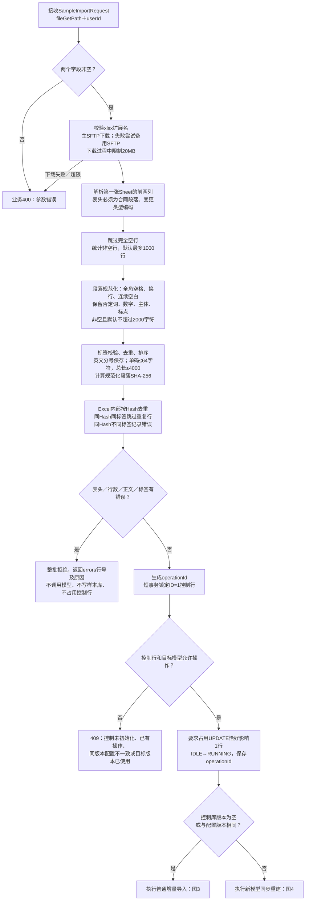
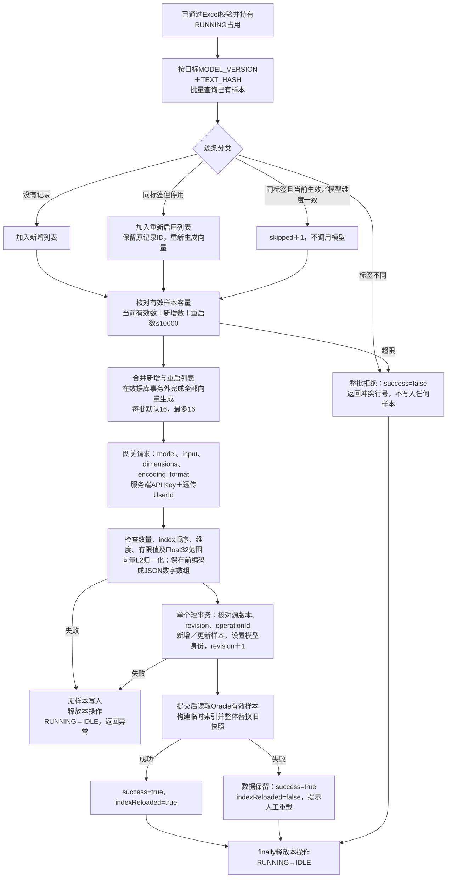
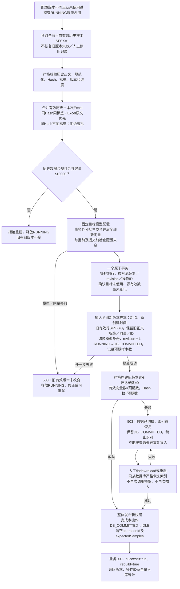
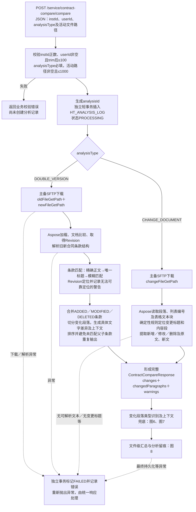
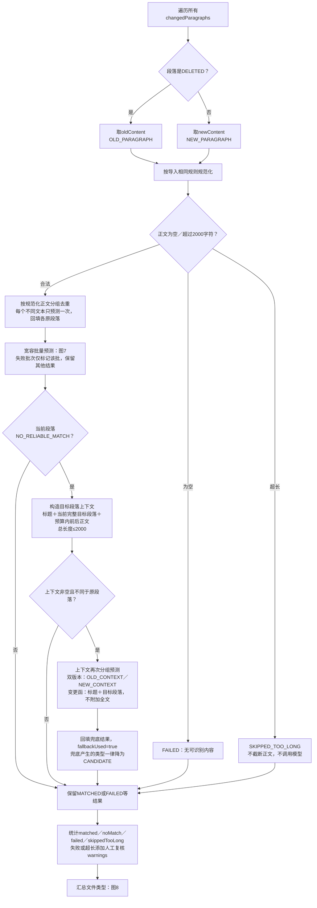
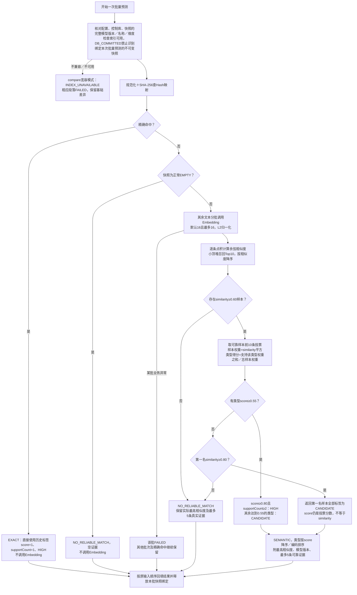
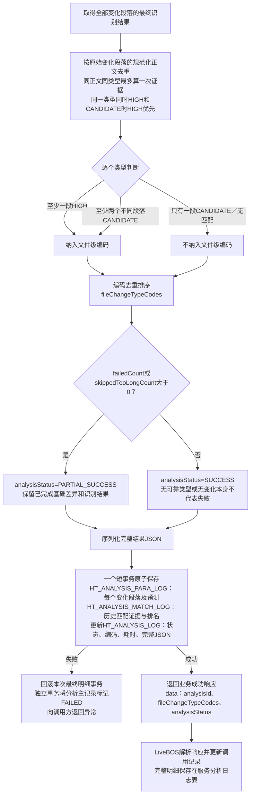
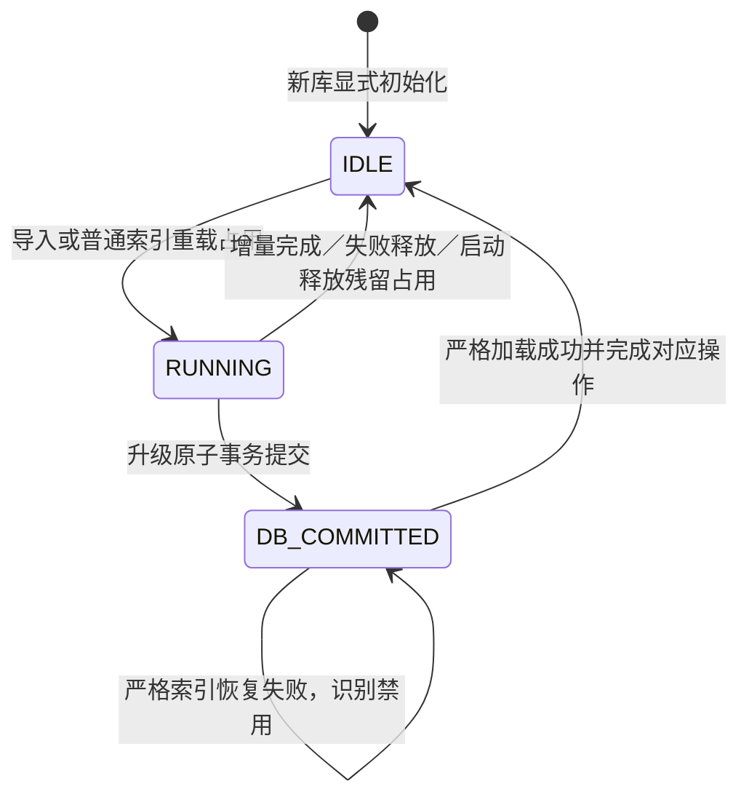

# 样本导入向量化与合同比对完整流程图

本图依据2026年10月12日项目代码整理。当前历史样本导入接收JSON服务器路径，不通过HTTP上传文件；`/compare`先提取文本变化，再利用有效历史样本识别业务变更类型。以下模型维度、容量和阈值均为默认配置，实际以部署配置为准。

## 1 总体数据流

历史样本标签来自Excel人工提供的编码。模型负责将文本转换为向量，业务类型由历史标签和检索规则产生。`/compare`不会自动把变化段落写入历史样本库。

## 2 Excel读取校验与导入分流

控制缺失时拒绝操作；模型身份未初始化但已有历史记录时也拒绝，不自动推断实际模型名称。目标`MODEL_VERSION`作为完整字符串比较；同版本还必须核对实际模型名称和维度。空库首次导入建立模型身份。初始化控制行显式设置`ID=1、REVISION=0、OPERATION_STATUS=IDLE`。

Java侧还核对控制行的状态、操作ID、预期样本数和模型身份是否一致；非法组合不会自动重置，也不会启用识别。

## 3 同版本增量导入及向量化

返回统计为`totalRows、inserted、updated、skipped、indexReloaded、errors`。全是同标签有效重复样本时不调用模型，仍执行模型身份／修订号处理及索引刷新。普通导入索引刷新失败后，仅版本兼容的已有可用快照可以继续识别。

同版本查重还检查返回记录的维度、生效状态、规范标签及Hash唯一性。异常记录整批拒绝，不当作停用记录自动重新向量化。增量事务写入前必须确认对应操作仍处于RUNNING。

## 4 新模型版本同步重建与失败恢复

升级返回`operationId、sourceVersion、targetVersion、totalSamples、insertedSamples、disabledSamples`。这里的入库统计是合并后的全量数量。`release`只能释放本操作的`RUNNING`，不会清掉`DB_COMMITTED`。

DB_COMMITTED索引恢复始终使用控制表保存的EXPECTED_SAMPLES，调用方不能用空参数绕过严格数量校验。

## 5 compare主流程和文件差异提取

基础差异的条款模糊匹配是文本规则，不是历史样本向量检索。Aspose Revision用于定位和辅助核查，结构化文本差异也会保留；无法细分的变化可能按整段替换并给出警告。

## 6 compare变化段落识别与上下文兜底

只有没有可靠匹配的段落才尝试上下文兜底，索引／模型失败和超长段落不会进入该兜底。正文轮和上下文轮各自固定一次批量预测快照，整个`/compare`并不是共用一个贯穿所有轮次的快照。

## 7 精确匹配和语义加权投票算法

多个标签的样本会给每个标签贡献完整样本权重，因此多标签得分之和不要求等于1。`similarity`是段落相似度，`score`是历史标签支持比例，两者均不是业务准确率。普通网关4xx直接失败；5xx或网络错误按配置重试，响应格式校验失败不重试。

## 8 文件级汇总、数据库留痕与返回

`NO_RELIABLE_MATCH`不会单独使合同变为`PARTIAL_SUCCESS`。响应外层成功码和`analysisStatus`应分别判断；项目直接响应通常为`code=200`，宿主环境转换后的外壳以实际集成约定为准。

## 9 控制表状态与启动恢复

单实例启动先释放残留`RUNNING`，不自动续跑导入；遇到`DB_COMMITTED`时只恢复索引。首次加载尚未完成时为`NOT_READY`，冷启动加载失败时实际标记为`LOAD_FAILED`；通过`/index/status`查看实际快照、配置版本和控制状态。普通构建发现坏向量、正文／Hash不一致、非规范标签或重复Hash会呈现`DEGRADED`，升级恢复则严格拒绝任何坏记录或数量不一致。

索引同时比较当前版本有效数量与按维度读取的数量；被维度过滤掉的有效记录计为坏记录，不能伪装为正常空库。SFTP连接方法保持原实现，沿用既有主备读取机制。

## 10 默认限制和主要数据表

| 项目 | 默认或固定规则 |
|---|---|
| 导入文件 | SFTP服务器xlsx，最大20MB |
| Excel格式 | 第一Sheet前两列：合同段落、变更类型编码 |
| 单次导入 | 默认最多1000条非空数据行 |
| 当前有效样本 | 默认最多10000条，失效旧记录不占容量 |
| 识别段落 | 规范化后默认最多2000字符 |
| 向量维度 | 默认1024，实际须与模型配置一致 |
| 模型批次 | 默认16，代码上限16 |
| 唯一约束 | MODEL_VERSION＋TEXT_HASH |
| 召回／投票／证据 | 默认10／10／5 |
| 相似度门槛 | 默认0.60 |
| 候选／HIGH | 默认score≥0.55；score≥0.80且支持数≥2为HIGH |
| 强相似兜底 | 默认第一名similarity≥0.80，一律CANDIDATE |

| 表 | 作用 |
|---|---|
| TPIF_HTDLYB | 各模型版本历史样本、标签及CLOB JSON向量 |
| HT_SAMPLE_LIBRARY | 单行控制信息、有效模型身份、修订号和最小恢复状态 |
| HT_ANALYSIS_LOG | compare分析主记录、状态、文件类型、完整结果JSON |
| HT_ANALYSIS_PARA_LOG | 变化段落、识别文本、范围、结果和兜底标志 |
| HT_ANALYSIS_MATCH_LOG | 各段落历史匹配样本、相似度、标签及排名 |

## 11 对应代码

- 路径读取与导入：`SftpContractFileLoader`、`SampleLibraryImportService`、`ContractParagraphImportService`。
- 模型网关与向量存储：`HttpEmbeddingClient`、`VectorCodec`、`VectorUtils`。
- 样本库事务与索引：`SampleLibraryStore`、`ParagraphVectorIndexService`。
- 合同分析编排：`ContractChangeAnalysisService`。
- 基础差异提取：`DoubleVersionChangeExtractor`、`ClauseComparisonEngine`、`ChangeDocumentExtractor`、`ChangeDocumentExtractionService`。
- 类型识别与汇总：`ContractComparePredictionService`、`ContractParagraphPredictionService`、`FileChangeTypeAggregator`。
- 分析留痕：`AnalysisResultPersistenceService`。

本文件为源码流程梳理，不表示真实LiveBOS、SFTP或Embedding环境已联调成功。
